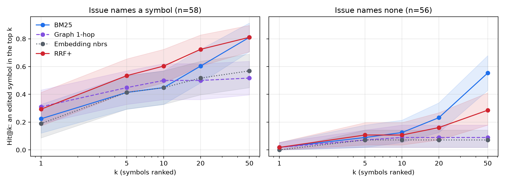
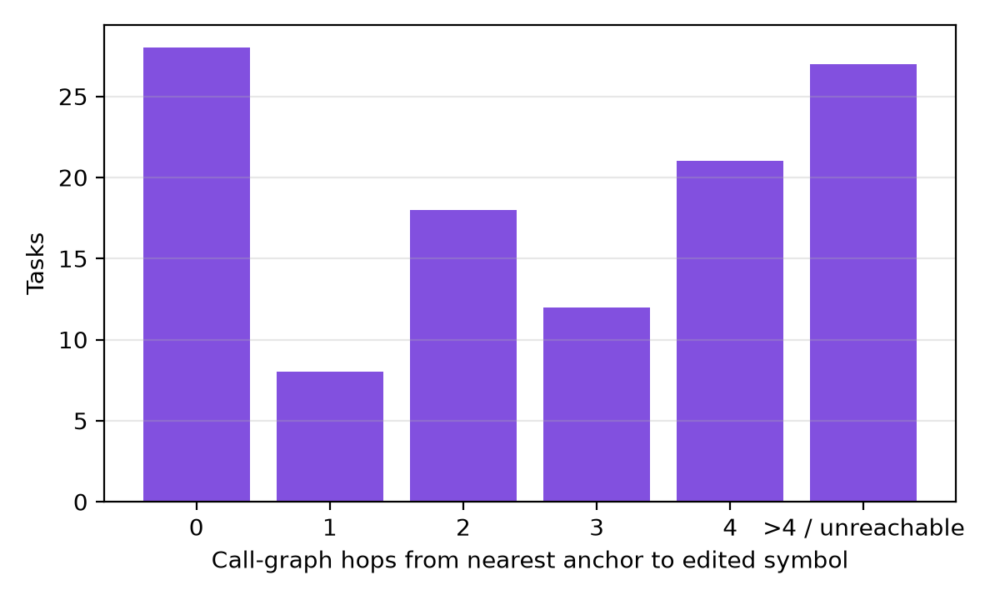
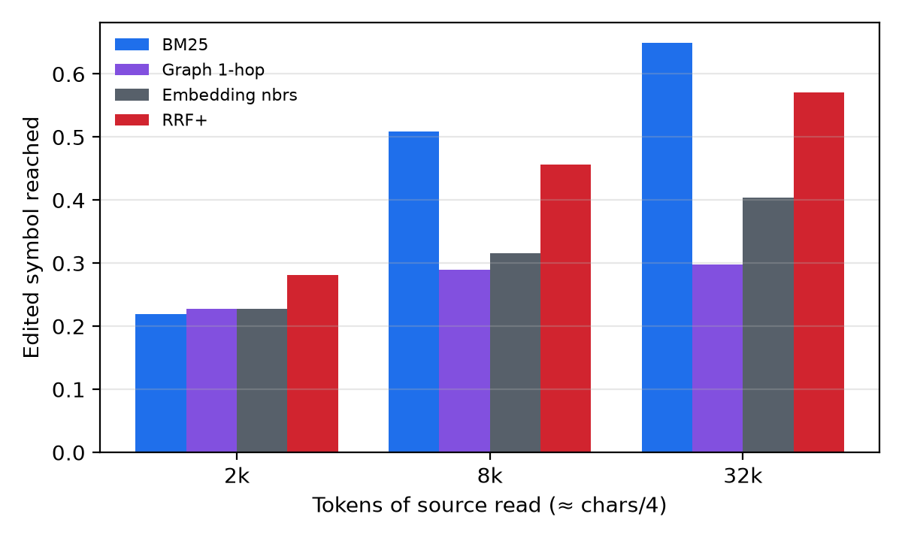
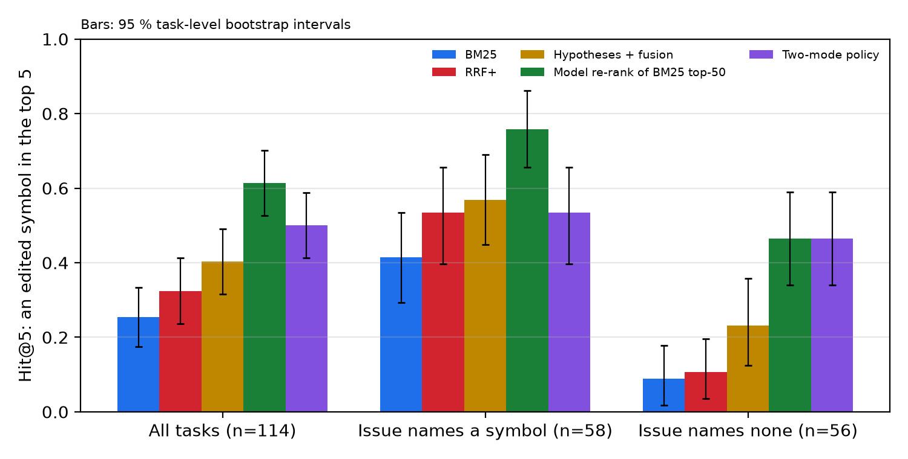

# Anchored or Not: Localization and Re-ranking in an Offline Gemma 4 Agent

*Issue anchors predict localization; model re-ranking recovers anchor-free issues; losses come after localization.*

## Abstract
An offline agent must find *where* to edit before it can edit. On the {{s:symbol_level/n|int}} public development tasks of the Gemma 4 Developer Agent competition that have symbol labels derived from reference patches, we measure how often the harness' code-intelligence signals (identifier resolution, call-graph expansion, embedding neighbours), BM25 and Gemma 4 31B as an untuned re-ranker put an edited symbol in the top 5 (Hit@5), and what limits the agent built on them. (1) **Anchors predict difficulty for every signal.** Issues that name a resolvable symbol ({{s:by_anchor/named_symbol/n|int}}) reach Hit@5 {{s:by_anchor/named_symbol/rrf+/R@5/0|pct}} with reciprocal-rank fusion, the other {{s:by_anchor/no_named_symbol/n|int}} only {{s:by_anchor/no_named_symbol/rrf+/R@5/0|pct}}; deeper in the ranking, BM25 finds far more for them than fusion or structure-based signals. (2) **The re-ranker recovers anchor-free issues** (Hit@5 {{s:by_anchor/no_named_symbol/bm25/R@5/0|pct}} → {{llm:no_named_symbol/rerank50/R@5/0|pct}}, pre-specified; Holm p {{llm:tests/H2_anchorfree_R@5/rerank50/mcnemar_p_holm|p}}) for a median {{llm:cost/latency_s_p50|f2}} s of batched model time per task, but the anchor gap stays about as large as under BM25, and post hoc, anchors still predict success after controlling for issue–code lexical overlap. (3) **The agent loses issues after localization:** of {{agent:failure/unresolved_runs|int}} unresolved runs, {{agent:failure/unresolved/WRONG_FILE|int}} edited only wrong files, and {{agent:failure/no_edit_read_gold|int}} of the {{agent:failure/unresolved_no_edit|int}} that never edited had read a file the fix edits. A serialization failure, diagnosed in all {{ser:eras/edit_file/edit_file/missing_found_in_value|int}} malformed two-argument edit calls, touches {{agent:failure/unresolved_with_malformed_edit|int}} of the unresolved runs. Four repositories and one model bound these conclusions.<!-- claim: s:by_anchor/no_named_symbol/rrf+/R@5/0 < 0.15 --><!-- claim: s:by_anchor/no_named_symbol/bm25/R@50/0 > s:by_anchor/no_named_symbol/rrf+/R@50/0 --><!-- claim: s:by_anchor/no_named_symbol/bm25/R@50/0 > s:by_anchor/no_named_symbol/emb/R@50/0 --><!-- claim: s:by_anchor/no_named_symbol/bm25/R@50/0 > s:by_anchor/no_named_symbol/graph/R@50/0 --><!-- claim: llm:tests/H2_anchorfree_R@5/rerank50/mcnemar_p_holm < 0.05 --><!-- claim: post:gap_minus_rerank/bm25/1 < 0 --><!-- claim: post:gap_minus_rerank/bm25/2 > 0 --><!-- claim: post:or_anchored/rerank50/1 > 1 --><!-- claim: agent:failure/wrong_file_share < 0.2 --><!-- claim: agent:failure/no_edit_read_gold > agent:failure/unresolved/WRONG_FILE -->

## 1. Introduction
The Gemma 4 Developer Agent harness offers three code-intelligence tools — `search_similar_code` over pre-computed node embeddings, `get_code_neighbors` and `get_code_subgraph` over a call graph — alongside shell and file tools, under tight budgets (≈ 6 min per hidden task, 32k-token context). `search_similar_code` resolves its query against **symbol names**, not free text: the tools are only as good as the anchors an agent can give them.

We contribute:
1. a symbol-level measurement of identifier, lexical, embedding, graph and model re-rank signals, split by whether the issue names a resolvable symbol, with pre-specified model hypotheses;
2. a failure decomposition of the agent's development runs, with a per-call diagnosis of a tool-serialization failure.

## 2. Setting and data
The dev set has {{s:coverage/tasks|int}} tasks from fastapi, rich, requests and httpx; {{s:coverage/source_change|int}} change non-test, non-documentation source. Each commit ships a call graph (nodes are fully qualified symbols with source text; edges are `calls`) and 256-d node embeddings. The hidden test set (≈ 120 tasks) comes from private repositories, so we favour conclusions about *signal types* over repository-specific tuning.

## 3. Method
**Gold symbols.** For each hunk in a source file of the reference patch, the gold symbol is the node whose source contains most of the hunk's removed lines (at least half, matched as stripped text, ignoring imports and comments; pure additions: ≥ 2 context lines). {{s:coverage/hunks_mapped|int}} of {{s:coverage/hunks_total|int}} hunks map; the rest are module-level — imports or comments ({{audit:kinds/unmapped: edit: imports or comments|int}}), code outside any symbol ({{audit:kinds/unmapped: edit: module-level code outside any symbol|int}}), new module-level code or definitions — or lines that matched no node ({{audit:kinds/unmapped: edit: lines not matched (whitespace or duplication)|int}}). {{s:symbol_level/n|int}} tasks have at least one gold symbol. The labels are rule-based: for {{s:coverage/label_full_coverage/0|int}} of {{s:coverage/label_full_coverage/1|int}} mapped edit hunks every removed line occurs in the chosen symbol (the same text test at 100 %), and git's `@@` hunk-header name, an independent check, agrees on {{audit:counts/header_agree|int}} of {{audit:counts/header_checked|int}} ({{audit:kinds/disagree: header names the preceding top-level def or class (git funcname heuristic)|int}} disagreements are git naming the *preceding* definition).

**Signals (issue text only).** *Identifiers*: back-ticked names, dotted names, CamelCase, snake_case and calls, resolved like the harness (exact → dotted suffix → case-insensitive → substring); *Identifiers+* adds traceback frames, imports and calls from code blocks. An issue is *anchored* when an Identifiers+ name resolves; otherwise BM25's top 3 serve as anchors. *BM25* indexes node-id tokens (double weight) and source. *Embedding neighbours* and *graph expansion* (1 or 2 hops) start from three anchors. *RRF* fuses identifiers, BM25, embedding neighbours and one-hop expansion by reciprocal rank (k = 60); *RRF+* fuses Identifiers+, BM25, embedding neighbours of its anchors and two-hop expansion.

**Model.** Gemma 4 31B QAT ({{llm:meta/vllm/gpus|int}}× L4, vLLM, temperature 0, thinking off, prompts hashed `{{llm:meta/prompt_sha}}`) ran on all {{llm:meta/n_ok|int}} tasks: *hypotheses* (symbols it names from the issue and a module list), *hypotheses + fusion* (added to RRF), and *re-rank* (it picks the 10 most likely of BM25's top 50, each shown by id, signature and first docstring line, and these lead BM25's order). The *two-mode policy* uses RRF+ when anchored and the re-rank otherwise. Pre-specified before the model outputs existed (commit `6a28d29`): H1, the policy beats RRF+ and BM25 overall; H2, on anchor-free issues the re-rank and hypotheses + fusion beat BM25; H3, hypotheses + fusion beat RRF+ overall.

**Metrics and inference.** Hit@k is the share of tasks with at least one edited symbol among the first k (Recall@k in earlier drafts). The *reading budget* counts tokens of source (characters/4) read down the ranking until the first edited symbol, like the EXAM effort score (Wong et al., 2016). Intervals are 95 % percentiles of 10,000 task-level bootstrap resamples (seed 0); paired comparisons use exact McNemar tests with Holm correction per family. Parameters are common defaults (k = 60, three anchors, BM25 k1 = 1.2, b = 0.75), but an exploratory pass on the same tasks preceded the declared comparison family (RRF+ against every signal at top-5 and top-20) and the 50 % label rule: only H1–H3 are strictly pre-specified, and later comparisons are marked *post hoc*.

## 4. Results
**4.1 Overall (declared comparisons).** Across {{s:symbol_level/n|int}} tasks, RRF+ reaches Hit@5 {{s:symbol_level/rrf+/R@5|ci}} and Hit@20 {{s:symbol_level/rrf+/R@20|ci}}; BM25 is the best single signal in depth (Hit@50 {{s:symbol_level/bm25/R@50|ci}}), and one-hop expansion finds an edited *file* in the top 5 for {{s:file_level/graph/R@5|ci}} of {{s:file_level/n|int}} source-changing tasks. RRF+ beats identifiers and embedding neighbours at top-5 and top-20 and one-hop expansion at top-20 (Holm p {{s:comparisons/rrf+_vs_others_R@20/graph/mcnemar_p_holm|p}} for the latter), but not two-hop expansion, RRF or BM25 at either depth; its top-5 advantage over BM25 is {{s:comparisons/rrf+_vs_others_R@5/bm25/diff|dpct}} (95 % CI {{s:comparisons/rrf+_vs_others_R@5/bm25/ci/0|dpct}} to {{s:comparisons/rrf+_vs_others_R@5/bm25/ci/1|dpct}}; Holm p {{s:comparisons/rrf+_vs_others_R@5/bm25/mcnemar_p_holm|p}}). Full family: [RESULTS.md](https://github.com/emamira02/gemma4-swe-agent/blob/main/paper/RESULTS.md).<!-- claim: s:symbol_level/bm25/R@50/0 >= s:symbol_level/ident/R@50/0 --><!-- claim: s:symbol_level/bm25/R@50/0 >= s:symbol_level/ident+/R@50/0 --><!-- claim: s:symbol_level/bm25/R@50/0 >= s:symbol_level/emb/R@50/0 --><!-- claim: s:symbol_level/bm25/R@50/0 >= s:symbol_level/graph/R@50/0 --><!-- claim: s:symbol_level/bm25/R@50/0 >= s:symbol_level/graph2/R@50/0 --><!-- claim: s:comparisons/rrf+_vs_others_R@5/ident/mcnemar_p_holm < 0.05 --><!-- claim: s:comparisons/rrf+_vs_others_R@5/emb/mcnemar_p_holm < 0.05 --><!-- claim: s:comparisons/rrf+_vs_others_R@20/ident/mcnemar_p_holm < 0.05 --><!-- claim: s:comparisons/rrf+_vs_others_R@20/emb/mcnemar_p_holm < 0.05 --><!-- claim: s:comparisons/rrf+_vs_others_R@20/graph/mcnemar_p_holm < 0.05 --><!-- claim: s:comparisons/rrf+_vs_others_R@20/graph/diff > 0 --><!-- claim: s:comparisons/rrf+_vs_others_R@5/graph/mcnemar_p_holm >= 0.05 --><!-- claim: s:comparisons/rrf+_vs_others_R@5/graph2/mcnemar_p_holm >= 0.05 --><!-- claim: s:comparisons/rrf+_vs_others_R@20/graph2/mcnemar_p_holm >= 0.05 --><!-- claim: s:comparisons/rrf+_vs_others_R@5/rrf/mcnemar_p_holm >= 0.05 --><!-- claim: s:comparisons/rrf+_vs_others_R@20/rrf/mcnemar_p_holm >= 0.05 --><!-- claim: s:comparisons/rrf+_vs_others_R@5/bm25/mcnemar_p_holm >= 0.05 --><!-- claim: s:comparisons/rrf+_vs_others_R@20/bm25/mcnemar_p_holm >= 0.05 -->

**4.2 Anchors.** {{s:coverage/issue_names_resolvable_symbol|int}} of {{s:coverage/source_change|int}} source-changing issues are anchored ({{s:by_anchor/named_symbol/n|int}} of the {{s:symbol_level/n|int}} with gold symbols). Anchored issues are easier for every signal, BM25 included: Hit@5 {{s:by_anchor/named_symbol/bm25/R@5/0|pct}} versus {{s:by_anchor/no_named_symbol/bm25/R@5/0|pct}} for BM25 and {{s:by_anchor/named_symbol/rrf+/R@5/0|pct}} versus {{s:by_anchor/no_named_symbol/rrf+/R@5/0|pct}} for RRF+ (Figure 1). Deeper down they part: without anchors, embedding neighbours ({{s:by_anchor/no_named_symbol/emb/R@50|ci}}) and one-hop expansion ({{s:by_anchor/no_named_symbol/graph/R@50|ci}}) stay low even at top-50, because their anchors are then BM25's top results, while BM25 itself reaches {{s:by_anchor/no_named_symbol/bm25/R@50/0|pct}}. The edited symbol is the nearest anchor itself in {{s:hop_distance/0|int}} tasks and 1, 2, 3 or 4 call-graph hops away in {{s:hop_distance/1|int}}, {{s:hop_distance/2|int}}, {{s:hop_distance/3|int}} and {{s:hop_distance/4|int}}; {{s:hop_distance/None|int}} are farther or unreachable (Figure 2).<!-- claim: s:by_anchor/named_symbol/bm25/R@5/0 > s:by_anchor/no_named_symbol/bm25/R@5/0 --><!-- claim: s:by_anchor/named_symbol/emb/R@5/0 > s:by_anchor/no_named_symbol/emb/R@5/0 --><!-- claim: s:by_anchor/named_symbol/graph/R@5/0 > s:by_anchor/no_named_symbol/graph/R@5/0 --><!-- claim: s:by_anchor/named_symbol/rrf+/R@5/1 > s:by_anchor/no_named_symbol/rrf+/R@5/2 --><!-- claim: s:by_anchor/no_named_symbol/emb/R@50/0 < 0.15 --><!-- claim: s:by_anchor/no_named_symbol/graph/R@50/0 < 0.15 -->

*Figure 1. Hit@k by anchor stratum; bands: 95 % intervals.*

*Figure 2. Call-graph hops from the nearest anchor to the edited symbol.*

**4.3 Without anchors, fusion dilutes BM25 in depth (post hoc).** Without anchors, BM25 alone recovers an edited symbol within the top 50 for {{s:by_anchor/no_named_symbol/bm25/R@50|ci}} of tasks, RRF+ for only {{s:by_anchor/no_named_symbol/rrf+/R@50|ci}}: a paired difference of {{s:comparisons/no_anchor_bm25_vs_fusion_R@50/rrf+/diff|dpct}} (95 % CI {{s:comparisons/no_anchor_bm25_vs_fusion_R@50/rrf+/ci/0|dpct}} to {{s:comparisons/no_anchor_bm25_vs_fusion_R@50/rrf+/ci/1|dpct}}; Holm p {{s:comparisons/no_anchor_bm25_vs_fusion_R@50/rrf+/mcnemar_p_holm|p}}); at top-20 it is {{s:comparisons/no_anchor_bm25_vs_fusion_R@20/rrf+/diff|dpct}} (Holm p {{s:comparisons/no_anchor_bm25_vs_fusion_R@20/rrf+/mcnemar_p_holm|p}}). Within 8k tokens of reading, BM25 and RRF+ reach an edited symbol for {{s:symbol_level/bm25/Hit@8k_tok|ci}} and {{s:symbol_level/rrf+/Hit@8k_tok|ci}} of all tasks (Holm p {{s:comparisons/rrf+_vs_others_Hit@8k_tok/bm25/mcnemar_p_holm|p}}; Figure 3).<!-- claim: s:comparisons/no_anchor_bm25_vs_fusion_R@50/rrf+/diff > 0 --><!-- claim: s:comparisons/no_anchor_bm25_vs_fusion_R@50/rrf+/mcnemar_p_holm < 0.05 --><!-- claim: s:comparisons/no_anchor_bm25_vs_fusion_R@20/rrf+/mcnemar_p_holm >= 0.05 --><!-- claim: s:comparisons/rrf+_vs_others_Hit@8k_tok/bm25/mcnemar_p_holm >= 0.05 -->

*Figure 3. Tasks whose first edited symbol is reached within N tokens of reading.*

**4.4 Robustness (declared parameters).** One-at-a-time variants of RRF k, anchor count and BM25 parameters keep RRF+ Hit@5 inside the main interval, but the main setting is the highest on all three axes (lowest variant: one anchor, {{sens:n_anchors=1/rrf+/R@5|pct}}), so its estimate is optimistic.<!-- claim: sens:n_anchors=1/rrf+/R@5 >= s:symbol_level/rrf+/R@5/1 --><!-- claim: sens:rrf_k=10/rrf+/R@5 >= s:symbol_level/rrf+/R@5/1 --><!-- claim: sens:bm25=(0.9, 0.4)/rrf+/R@5 >= s:symbol_level/rrf+/R@5/1 --><!-- claim: sens:bm25=(1.5, 0.9)/rrf+/R@5 >= s:symbol_level/rrf+/R@5/1 --><!-- claim: sens:rrf_k=60/rrf+/R@5 >= sens:rrf_k=10/rrf+/R@5 --><!-- claim: sens:rrf_k=60/rrf+/R@5 >= sens:rrf_k=30/rrf+/R@5 --><!-- claim: sens:rrf_k=60/rrf+/R@5 >= sens:rrf_k=100/rrf+/R@5 --><!-- claim: sens:n_anchors=3/rrf+/R@5 >= sens:n_anchors=1/rrf+/R@5 --><!-- claim: sens:n_anchors=3/rrf+/R@5 >= sens:n_anchors=5/rrf+/R@5 --><!-- claim: sens:bm25=(1.2, 0.75)/rrf+/R@5 >= sens:bm25=(0.9, 0.4)/rrf+/R@5 --><!-- claim: sens:bm25=(1.2, 0.75)/rrf+/R@5 >= sens:bm25=(1.5, 0.9)/rrf+/R@5 -->

**4.5 Without graph or embeddings (post hoc).** Task containers lack the graph and embeddings. Fusing traceback frames and identifiers with BM25 when they resolve, and BM25 alone otherwise, gives a lexical policy with Hit@5 {{s:symbol_level/lex/R@5|ci}}: {{s:comparisons/lex_vs_fusion_R@5/rrf+/diff|dpct}} versus RRF+ (95 % CI {{s:comparisons/lex_vs_fusion_R@5/rrf+/ci/0|dpct}} to {{s:comparisons/lex_vs_fusion_R@5/rrf+/ci/1|dpct}}) and {{s:comparisons/lex_vs_fusion_R@5/bm25/diff|dpct}} versus BM25 (Holm p {{s:comparisons/lex_vs_fusion_R@5/bm25/mcnemar_p_holm|p}}); at top-50, {{s:symbol_level/lex/R@50|ci}} versus {{s:symbol_level/rrf+/R@50|ci}} for RRF+ (Holm p {{s:comparisons/lex_vs_fusion_R@50/rrf+/mcnemar_p_holm|p}}). Our agent's localization skill implements this policy.<!-- claim: s:comparisons/lex_vs_fusion_R@5/rrf+/mcnemar_p_holm >= 0.05 --><!-- claim: s:comparisons/lex_vs_fusion_R@5/bm25/diff > 0 --><!-- claim: s:comparisons/lex_vs_fusion_R@5/bm25/mcnemar_p_holm < 0.05 --><!-- claim: s:comparisons/lex_vs_fusion_R@50/rrf+/diff > 0 --><!-- claim: s:comparisons/lex_vs_fusion_R@50/rrf+/mcnemar_p_holm < 0.05 -->

**4.6 Model in the loop: creating anchors (H2).** On anchor-free issues the re-rank raises Hit@5 from {{s:by_anchor/no_named_symbol/bm25/R@5|ci}} to {{llm:no_named_symbol/rerank50/R@5|ci}}: {{llm:tests/H2_anchorfree_R@5/rerank50/diff_new_minus_bm25|dpct}} (95 % CI {{llm:tests/H2_anchorfree_R@5/rerank50/ci_new_minus_bm25/0|dpct}} to {{llm:tests/H2_anchorfree_R@5/rerank50/ci_new_minus_bm25/1|dpct}}; Holm p {{llm:tests/H2_anchorfree_R@5/rerank50/mcnemar_p_holm|p}}); only the re-rank succeeded on {{llm:tests/H2_anchorfree_R@5/rerank50/other_only|int}} tasks, only BM25 on {{llm:tests/H2_anchorfree_R@5/rerank50/primary_only|int}}, and the gain at top-20 is {{llm:tests/H2_anchorfree_R@20/rerank50/diff_new_minus_bm25|dpct}} (Holm p {{llm:tests/H2_anchorfree_R@20/rerank50/mcnemar_p_holm|p}}). Hypotheses + fusion reach {{llm:no_named_symbol/hyp_fused/R@5|ci}}; the bootstrap interval of their gain excludes zero but the pre-specified McNemar test does not (Holm p {{llm:tests/H2_anchorfree_R@5/hyp_fused/mcnemar_p_holm|p}}), so H2 holds for re-ranking only. The server enforced valid JSON.<!-- claim: llm:tests/H2_anchorfree_R@5/rerank50/diff_new_minus_bm25 > 0 --><!-- claim: llm:tests/H2_anchorfree_R@5/rerank50/mcnemar_p_holm < 0.05 --><!-- claim: llm:tests/H2_anchorfree_R@20/rerank50/diff_new_minus_bm25 > 0 --><!-- claim: llm:tests/H2_anchorfree_R@20/rerank50/mcnemar_p_holm < 0.05 --><!-- claim: llm:tests/H2_anchorfree_R@5/hyp_fused/ci_new_minus_bm25/0 > 0 --><!-- claim: llm:tests/H2_anchorfree_R@5/hyp_fused/mcnemar_p_holm >= 0.05 --><!-- claim: llm:meta/rerank_parse_rate == 1 --><!-- claim: llm:meta/hyp_parse_rate == 1 -->

**The policy (H1) and hypothesis fusion (H3).** Over all tasks the policy reaches Hit@5 {{llm:all/policy/R@5|ci}}, versus {{s:symbol_level/rrf+/R@5/0|pct}} for RRF+ (Holm p {{llm:tests/H1_policy_R@5/rrf+/mcnemar_p_holm|p}}) and {{s:symbol_level/bm25/R@5/0|pct}} for BM25 (Holm p {{llm:tests/H1_policy_R@5/bm25/mcnemar_p_holm|p}}), also at top-20; as the policy is RRF+ on anchored issues, H1 restates H2's anchor-free gain. Hypotheses + fusion do not reliably beat RRF+ ({{llm:tests/H3_hypfused_R@5/rrf+/diff|dpct}}; Holm p {{llm:tests/H3_hypfused_R@5/rrf+/mcnemar_p_holm|p}}).<!-- claim: llm:tests/H1_policy_R@5/rrf+/diff > 0 --><!-- claim: llm:tests/H1_policy_R@5/rrf+/mcnemar_p_holm < 0.05 --><!-- claim: llm:tests/H1_policy_R@5/bm25/diff > 0 --><!-- claim: llm:tests/H1_policy_R@5/bm25/mcnemar_p_holm < 0.05 --><!-- claim: llm:tests/H1_policy_R@20/rrf+/diff > 0 --><!-- claim: llm:tests/H1_policy_R@20/rrf+/mcnemar_p_holm < 0.05 --><!-- claim: llm:tests/H1_policy_R@20/bm25/diff > 0 --><!-- claim: llm:tests/H1_policy_R@20/bm25/mcnemar_p_holm < 0.05 --><!-- claim: llm:tests/H3_hypfused_R@5/rrf+/mcnemar_p_holm >= 0.05 -->

**Post hoc: re-rank in both modes, and its ceiling.** On anchored issues the re-rank reaches Hit@5 {{llm:named_symbol/rerank50/R@5|ci}} versus {{s:by_anchor/named_symbol/rrf+/R@5/0|pct}} for RRF+ (Holm p {{llm:exploratory/rerank50_vs_rrf+_named_R@5/mcnemar_p_holm|p}}; this test and re-rank versus the policy share their discordant tasks). A re-ranker cannot recover what its pool misses: BM25's top 50 holds an edited symbol for {{llm:ceiling/all/reachable|ci}} of tasks, and on those the re-rank puts one in the top 5 for {{llm:ceiling/all/R@5_given_reachable|ci}} (Figure 4). Model time per task, for both calls under concurrent batching, had median {{llm:cost/latency_s_p50|f2}} s (p90 {{llm:cost/latency_s_p90|f2}} s) and a mean of {{llm:cost/tokens_per_task_mean|rint}} tokens.<!-- claim: llm:exploratory/rerank50_vs_rrf+_named_R@5/diff > 0 --><!-- claim: llm:exploratory/rerank50_vs_rrf+_named_R@5/mcnemar_p_holm < 0.05 --><!-- claim: llm:ceiling/all/R@5_given_reachable/0 > llm:ceiling/all/reachable/0 --><!-- claim: llm:cost/latency_s_p50 < 18 -->

*Figure 4. Hit@5 with and without the model, by anchor stratum; bars: 95 % intervals.*

**Why the anchor gap persists (post hoc; plan committed in `cd93427` before the analysis code, with the first two point estimates already known).** The anchor gap in Hit@5 is {{post:gap/rerank50|dci}} for the re-rank, {{post:gap/bm25|dci}} for BM25 and {{post:gap/rrf+|dci}} for RRF+ (stratified resampling); the re-rank's gap differs from BM25's by {{post:gap_minus_rerank/bm25|dci}} and from RRF+'s by {{post:gap_minus_rerank/rrf+|dci}}, so it is not shown to be narrower. Writing Hit@5 as reachability (BM25's top 50 holds an edited symbol: {{post:R/anchored/0|pct}} anchored, {{post:R/anchor_free/0|pct}} anchor-free) times ranking given reachability ({{post:C/anchored/0|pct}}, {{post:C/anchor_free/0|pct}}) attributes {{post:share_reachability|ci}} of the re-rank's gap to reachability: by the registered criterion, an interval above 50 %, the split is not resolved. With issue–code lexical overlap in a logistic model, anchors still predict Hit@5 for BM25, RRF+ and the re-rank (odds ratio {{post:or_anchored/rerank50|f2ci}} for the re-rank; {{post:unestimable_resamples/or_anchored/bm25|int}} and {{post:unestimable_resamples/or_anchored/rrf+|int}} resamples could not be fitted for BM25 and RRF+), and anchor-free issues overlap slightly more with the gold code. The gap also holds within fastapi and within rich (descriptive, not registered).<!-- claim: post:gap_minus_rerank/bm25/1 < 0 --><!-- claim: post:gap_minus_rerank/bm25/2 > 0 --><!-- claim: post:gap_minus_rerank/rrf+/1 < 0 --><!-- claim: post:share_reachability/1 < 0.5 --><!-- claim: post:overlap_mean/anchor_free > post:overlap_mean/anchored --><!-- claim: post:or_anchored/bm25/1 > 1 --><!-- claim: post:or_anchored/rrf+/1 > 1 --><!-- claim: post:or_anchored/rerank50/1 > 1 --><!-- claim: post:by_repo_hit5_unregistered/fastapi~fastapi/anchored/rerank50_rate > post:by_repo_hit5_unregistered/fastapi~fastapi/anchor_free/rerank50_rate --><!-- claim: post:by_repo_hit5_unregistered/Textualize~rich/anchored/rerank50_rate > post:by_repo_hit5_unregistered/Textualize~rich/anchor_free/rerank50_rate --><!-- claim: post:by_repo_hit5_unregistered/fastapi~fastapi/anchored/rrf+_rate > post:by_repo_hit5_unregistered/fastapi~fastapi/anchor_free/rrf+_rate --><!-- claim: post:by_repo_hit5_unregistered/Textualize~rich/anchored/rrf+_rate > post:by_repo_hit5_unregistered/Textualize~rich/anchor_free/rrf+_rate -->

**4.7 The agent.** Our agent runs the lexical policy of 4.5 in the task container, lets the model pick among the printed symbols, reads one to three ranges, edits, and checks the patch before `submit_patch`. Configurations S1–S5 each ran once, with the scorer's settings, on the same {{agent:runs/S1/panel/n|int}} rich tasks; the reference patch passes on {{agent:failure/solvable_runs|int}} of {{agent:failure/task_runs|int}} task runs ({{agent:runs/S1/panel/gold_solvable|int}} or {{agent:runs/S3/panel/gold_solvable|int}} per run: the environment is noisy). On {{agent:failure/rank1_rate|pct}} of these the policy ranks an edited file first, yet each configuration resolves only {{agent:failure/resolved_min|int}}–{{agent:failure/resolved_max|int}} tasks. Of {{agent:failure/unresolved_runs|int}} unresolved runs, {{agent:failure/unresolved/WRONG_FILE|int}} edited only files the fix leaves untouched, {{agent:failure/unresolved_right_file|int}} edited one it touches but timed out ({{agent:failure/unresolved/RIGHT_FILE_TIMEOUT|int}}) or submitted a wrong fix ({{agent:failure/unresolved/RIGHT_FILE_WRONG_FIX|int}}), and {{agent:failure/unresolved_no_edit|int}} never applied an edit, though {{agent:failure/no_edit_read_gold|int}} of these had read such a file ({{agent:failure/no_edit_rank1_gold|int}} ranked first by the policy). {{agent:failure/tools/edit_file/malformed|int}} of {{agent:failure/tools/edit_file/calls|int}} `edit_file` calls arrived with an argument missing, and all {{ser:eras/edit_file/edit_file/missing_found_in_value|int}} show one mechanism: the published chat template lists tool parameters in sorted order, the model emits them so ({{ser:eras/edit_file/edit_file/well_formed_alphabetical|int}} of {{ser:eras/edit_file/edit_file/well_formed|int}} well-formed calls), and vLLM's gemma4 parser ends a string only at a dedicated token, so `old_string` sits inside `new_string`, after the backtick ({{ser:eras/edit_file/edit_file/closer_before_swallowed_key/backtick|int}}) or quote ({{ser:eras/edit_file/edit_file/closer_before_swallowed_key/double_quote|int}}) that closed it. `write_file`, whose `content` sorts before `filepath`, lost `filepath` the same way in {{ser:eras/edit_file/write_file/missing_found_in_value|int}} of {{ser:eras/edit_file/write_file/calls|int}} calls. These failures touch {{agent:failure/unresolved_with_malformed_edit|int}} of the unresolved runs. Later configurations pass code in one argument; the eras below also differ in prompt, budget, sampling and panel: system comparisons.<!-- claim: ser:eras/edit_file/edit_file/missing_found_in_value == agent:failure/tools/edit_file/malformed --><!-- claim: ser:eras/edit_file/edit_file/missing_found_in_value == ser:eras/edit_file/edit_file/missing_required --><!-- claim: ser:eras/edit_file/write_file/missing_found_in_value == ser:eras/edit_file/write_file/missing_required --><!-- claim: agent:failure/rank1_rate > 0.5 --><!-- claim: agent:failure/wrong_file_share < 0.2 --><!-- claim: agent:failure/unresolved_right_file > agent:failure/unresolved/WRONG_FILE --><!-- claim: agent:failure/unresolved_no_edit > agent:failure/unresolved/WRONG_FILE --><!-- claim: agent:failure/resolved_max <= agent:runs/S1/panel/gold_solvable --><!-- if:lb --> Public leaderboard scores come from one scored run per configuration on the hidden tasks; differences between configurations are not tested.<!-- endif --><!-- if:!lb --> No public leaderboard score had been returned when this paper was built; the table shows each configuration's status.<!-- endif -->

{{agentmd:eras}}

## 5. Implications for agent design
1. **Detect the mode first:** whether any identifier resolves predicts how hard localization will be; without anchors, structure-based tools are not worth their calls.
2. **Re-rank BM25's candidates with the model,** and spend further effort on the pool, which bounds the re-rank.
3. **Make a code-valued string the only or the last argument in sorted key order:** with this serving stack, a string the model closes with a backtick or quote swallows every later argument.

## 6. Related work
In IR-based bug localization, reports that name buggy files inflate accuracy (Kochhar et al., 2014), program-entity names largely decide whether developers are helped (Wang et al., 2015), and queries can be reformulated by report type (Rahman and Roy, 2018); we carry this distinction to an agent harness and a model re-ranker. SWE-bench (Jimenez et al., 2024) introduced repository-level issue resolution with BM25; SWE-agent (Yang et al., 2024) showed that the agent–computer interface matters, as our serialization failure confirms. Agentless (Xia et al., 2024) localizes hierarchically; RepoGraph (Ouyang et al., 2025) and LocAgent (Chen et al., 2025) build repository graphs, LocAgent relating success to graph distance from mentioned functions. Bellam (2026) stratifies SWE-bench Verified by hop depth and finds that small agents, Gemma 4 among them, use graph tools mostly for name lookup and one expansion; we add issues without resolvable names and a model re-ranker. SweRank (Reddy et al., 2026) fine-tunes a listwise re-ranker and finds retrieval not to be the bottleneck behind a trained retriever; behind BM25, with an untuned quantized model, the pool is. Caumartin et al. (2026) report large file-level gains from LLM re-ranking; Sam-Bodden (2026) fixes localization with an oracle to study acting. On these tasks, Hassan (2026) benchmarks model-free signals and Wold (2026) pre-registered a study of anchor distance and E4B failures; we add symbol labels, the model re-rank per stratum and the agent's losses. RRF follows Cormack et al. (2009); BM25, Robertson and Zaragoza (2009).

## 7. Limitations
Four public repositories, dominated by fastapi and rich, and one model: the hidden set is private, and these tasks informed every design choice, so post hoc results need new tasks. Labels come from a text-matching rule, exclude module-level edits and take the reference patch as the one correct fix. The model results come from one prompt pair and one greedy run; batched inference is not bit-reproducible, so the analysis re-runs from saved outputs. The model has likely seen these popular repositories in pre-training; the re-ranker sees only issue text, names, signatures and docstring lines, which limits but does not exclude memorisation. The agent decomposition covers five single runs on one rich panel.

## 8. Reproducibility
Code and result files: https://github.com/emamira02/gemma4-swe-agent. Competition data are never redistributed: `scripts/fetch_data.sh` downloads the dev subset, and `python -m locstudy all` recomputes every localization table and figure from `data/`, with data hashes, commit and parameters (a full rerun reproduced every value). Kaggle kernels produce the model outputs (`kernels/llm-localization`) and agent traces, which stay private as they contain task text; `locstudy llm`, `analysis.anchor_posthoc`, `analysis.failure_audit`, `tools/agent_summary.py` and `analysis.serialization_audit` derive the committed result files, which keep task ids and counts only. [`paper/CLAIMS.md`](https://github.com/emamira02/gemma4-swe-agent/blob/main/paper/CLAIMS.md) maps every number to its result key; the build fails if a guarded claim contradicts the results.

## References

Bellam, S. (2026). How do small coding agents use code graphs and embeddings? arXiv:2610.33958.

Caumartin, G., Chen, T.-H., Costa, D. E. (2026). Retrieval-oriented code representations in agentic bug localization. arXiv:2607.11046.

Chen, Z., et al. (2025). LocAgent: Graph-guided LLM agents for code localization. ACL.

Cormack, G. V., et al. (2009). Reciprocal rank fusion outperforms Condorcet and individual rank learning methods. SIGIR.

Hassan, A. (2026). Model-free localization benchmark on the 129 public tasks. Kaggle discussion 748395.

Holm, S. (1979). A simple sequentially rejective multiple test procedure. Scandinavian Journal of Statistics.

Jimenez, C. E., et al. (2024). SWE-bench: Can language models resolve real-world GitHub issues? ICLR.

Kochhar, P. S., Tian, Y., Lo, D. (2014). Potential biases in bug localization: Do they matter? ASE.

McNemar, Q. (1947). Note on the sampling error of the difference between correlated proportions or percentages. Psychometrika.

Ouyang, S., et al. (2025). RepoGraph: Enhancing AI software engineering with repository-level code graph. ICLR.

Rahman, M. M., Roy, C. K. (2018). Improving IR-based bug localization with context-aware query reformulation. ESEC/FSE.

Reddy, R. G., et al. (2026). SweRank: Software issue localization with code ranking. ICLR.

Robertson, S., Zaragoza, H. (2009). The probabilistic relevance framework: BM25 and beyond. Foundations and Trends in IR.

Sam-Bodden, B. (2026). What context does a coding agent actually need to act? arXiv:2607.09691.

Wang, Q., Parnin, C., Orso, A. (2015). Evaluating the usefulness of IR-based fault localization techniques. ISSTA.

Wold, J. (2026). Pre-registration: anchor distance and small-agent failure. Kaggle discussion 750732.

Wong, W. E., et al. (2016). A survey on software fault localization. IEEE TSE.

Xia, C. S., et al. (2024). Agentless: Demystifying LLM-based software engineering agents. arXiv:2407.01489.

Yang, J., et al. (2024). SWE-agent: Agent-computer interfaces enable automated software engineering. NeurIPS.
